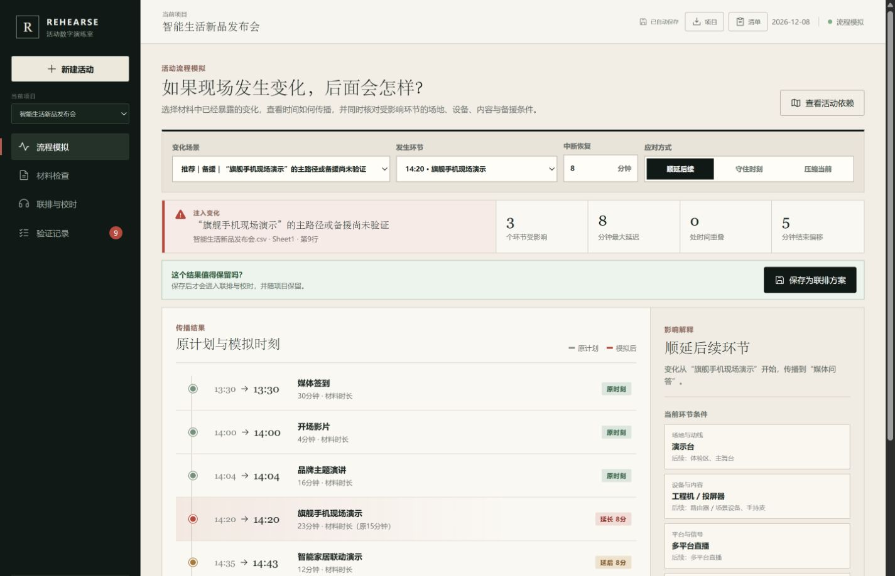
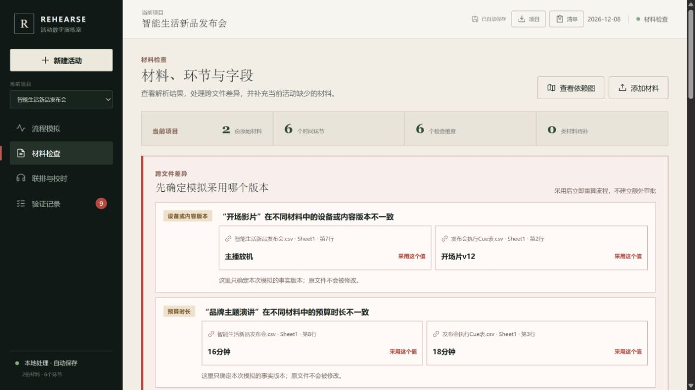

# REHEARSE

把静态活动材料变成一个可以注入变化、观察连锁影响并真实联排的流程模拟器。

REHEARSE（活动数字演练室）读取团队手边已有的流程表、Cue表、讲稿和技术材料，把它们编译成同一条活动时间线。用户可以注入“环节延迟、设备失效、版本差异、动线受阻”等变化，比较顺延后续、守住原时刻或压缩当前环节时会发生什么，再把选中的方案带入真人联排。它不负责现场播控，也不要求团队迁移到一套新任务系统。

> **项目状态：v0.1.0 public-preview candidate。** 核心流程、导入导出和确定性回归基准已可复验，CI 与 Docker 检查已配置；它不是现场播控系统，也不对任意生产文档作 100% 识别承诺。



## 60 秒试用

```bash
npm ci
npm run dev
```

打开本地地址，选择“新建活动 → 科技发布会”。无需准备材料即可走通版本确认、变化注入、策略比较、真人校时和验证记录；随后再导入自己的 XLSX、CSV、DOCX、PDF、JSON、TXT 或 Markdown。

## 解决什么问题

流程表能说明“正常情况下几点做什么”，但很难即时回答“这里晚了6分钟，后面哪些环节会被挤压；如果不改时刻，会出现几处重叠”。REHEARSE 专门补这一层，不和现有排期、报名、任务分工或现场 cue 软件争同一份工作。

最适合在活动前 24—72 小时使用：多部门协作、存在直播或舞台切换、对外口径、样品库存或复杂动线，并且一次失误的返工和声誉成本较高。单人执行、流程固定的小型活动，继续使用原流程表通常已经足够。

它集中回答：

- 下一步还缺哪类材料、通常从哪里取得？没有现成文件时能用什么信息替代？
- 讲稿预估和真人跑稿时长是否符合流程预算，会不会挤掉下一环节？
- 某个环节延迟或中断后，变化会传播到哪里？
- 守住原时刻会形成哪些重叠，顺延又会推迟多久结束？
- 场地、设备、内容和平台条件会在哪些后续环节重新出现？
- 这条风险来自哪份材料、哪一行？
- 复测通过后，问题有没有真正闭合？

REHEARSE 把这些问题连接成一条可追溯闭环：

```text
手边已有材料 → 跨文件版本确认 → 可追溯活动模型
             → 注入变化 → 传播计算 → 方案比较
             → 真人联排与校时 → 验证记录 → 执行清单
```

## 五个核心动作

1. **从一份流程表开始**：支持 XLSX、XLS、CSV、DOCX、PDF、JSON、TXT、Markdown，浏览器本地处理原文件。
2. **编译多份材料**：把同名环节的时间、时长、场地和设备逐项对照，直接指出哪两份文件、哪一行给出了不同版本；用户可在产品内选择本次模拟采用的值，原文件保持不变。
3. **注入变化并计算传播**：系统区分“开始延后、时长增加、中断恢复”，避免把所有分钟数都误算成晚开始；再实时比较“顺延后续、守住原时刻、压缩当前”三种结果。
4. **核对内容与流程时间**：文字量只作预估；完整的排练录音／视频或真人计时优先，并把真实时长重新带入流程模拟。明显短于流程预算的片段会先标为异常证据，不会自动覆盖文字估算。
5. **真实联排闭环**：朗读模拟方案，从变化环节走到最后一个受影响环节，记录实际结果并导出流程模拟与联排清单。



## 本地运行

```bash
# 下载代码并进入项目目录后（需要 Node.js 22.12+）
npm ci
npm run dev
```

打开终端显示的本地地址。产品自带七类结构不同的公开活动样本：品牌盛典、科技发布会、美妆体验节、伙伴大会、多城消费者活动、户外市集和培训会。样本的公开依据与转写边界见 [公开案例验证基线](docs/PUBLIC_VALIDATION.md)。

验证完整构建：

```bash
npm run check
```

`npm run check` 会依次执行夹具评测、46 项自动化测试和生产构建。当前 `fixture-0.1.0` 基准覆盖 7 类活动、45 个环节与 30 条流程风险；元数据、环节抽取、时长、来源行号、跨文件差异、必需风险召回、风险可追溯性和模拟覆盖在该基准中均为 100%。这是可复现的回归结果，不是对任意活动文件的泛化准确率。完整口径与机器可读输出见 [评测说明](docs/EVALUATION.md)。

使用 Docker：

```bash
docker compose up --build
```

然后访问 `http://localhost:8080`。

## 演示路径

1. 打开“新建活动”，证明用户只需先交一份能看出“几点做什么”的流程材料。
2. 在“材料检查”采用两份文件发生冲突时的一个版本，证明模拟基线可以回溯到原文件和行号。
3. 进入“流程模拟”，选择一个材料中已经暴露的变化并调整分钟数。
4. 切换“顺延后续、守住原时刻、压缩当前”，观察受影响环节、最大延迟、时间重叠和结束偏移如何变化。
5. 保存一个方案，进入“联排与校时”，导入完整排练录音／视频或人工计时；异常短片段需确认后才能作为实测依据。
6. 朗读联排口令并记录现场结果，再导出流程模拟与联排清单。

完整的20分钟演示脚本见 [docs/DEMO_SCRIPT.md](docs/DEMO_SCRIPT.md)。

## 可信边界

REHEARSE 不把“AI生成”当作真实性保证。

- **事实层**：原始文件、表格行号、PDF页码、用户明确修改。
- **规则层**：时间冲突、版本差异、备援待确认、来源缺失。
- **演练层**：变化注入、传播结果、策略比较和联排范围。
- **人工边界**：场地容量、人群感受、设备切换、内容口径和现场可行性必须由专业人员确认。

当前默认引擎使用可解释的本地规则。未来的模型适配器应作为增强项，并通过服务端或企业网关连接；不要把企业 Token 写入浏览器代码。

## 为什么不直接用豆包或其他通用 AI

可以用，而且它们很适合总结材料、改讲稿、写通知和搭建轻量应用。REHEARSE 不声称模型比通用 AI 更聪明；它把活动团队每次都要重新描述的模拟条件固化成一个可复跑产品：保存来源证据、确定模拟采用的版本、用真人计时覆盖文字估算、计算变化传播，并保留联排结果。

如果只是一次性总结或生成文案，直接用豆包更省事。只有当活动复杂到需要多份材料反复更新、比较现场变化的连锁影响并在开场前真实联排时，REHEARSE 才有明确优势。对照边界和可复验用例见 [与通用 AI 的能力对照](docs/COMPETITIVE_VALIDATION.md)。

## 项目格式

项目可以导出为 `.rehearse.json` 并重新导入。导入时会按 [schema/rehearse-project.schema.json](schema/rehearse-project.schema.json) 完整校验，而不是只相信文件名或项目 ID。这为未来的 CLI、模型适配器和飞书等协作平台集成保留了稳定边界。

## 结构

```text
File adapters        Event model          Simulation engine       Outputs
XLSX / DOCX / PDF → moments + dimensions → scenario + timeline  → brief / JSON
CSV / JSON / text   → sources + evidence → strategies + reruns  → browser voice
```

更多说明见 [docs/ARCHITECTURE.md](docs/ARCHITECTURE.md)。

## 当前限制

- 结构识别仍以确定性规则为主，复杂合并单元格、扫描版 PDF 和隐含关系可能需要人工修正。
- 项目保存在浏览器本地，尚无多人实时协作与权限控制。
- 浏览器语音质量取决于操作系统可用音色。
- 讲稿文字时长是基于可调语速的估算，不代替真人跑稿；只有完整且经合理性检查的音视频实测或人工计时结果才可作为现场排期证据。
- 原始音视频不会随项目持久化；项目只保存时长、文件名、分段与 SHA-256 指纹。再次打开项目时需要重新选择原文件才能播放波形。
- 当前评测覆盖代表性样本，不代表已经达到生产级材料识别准确率。

这些边界会被明确展示，不会包装成“AI准确率”。评测计划见 [docs/EVALUATION.md](docs/EVALUATION.md)。

## Contributing

欢迎提交可公开分享的材料结构、解析失败样本、演练方法和代码改进。请勿把企业内部材料直接提交到公开仓库；先阅读 [CONTRIBUTING.md](CONTRIBUTING.md) 与 [SECURITY.md](SECURITY.md)。

## License

Apache License 2.0. See [LICENSE](LICENSE).
